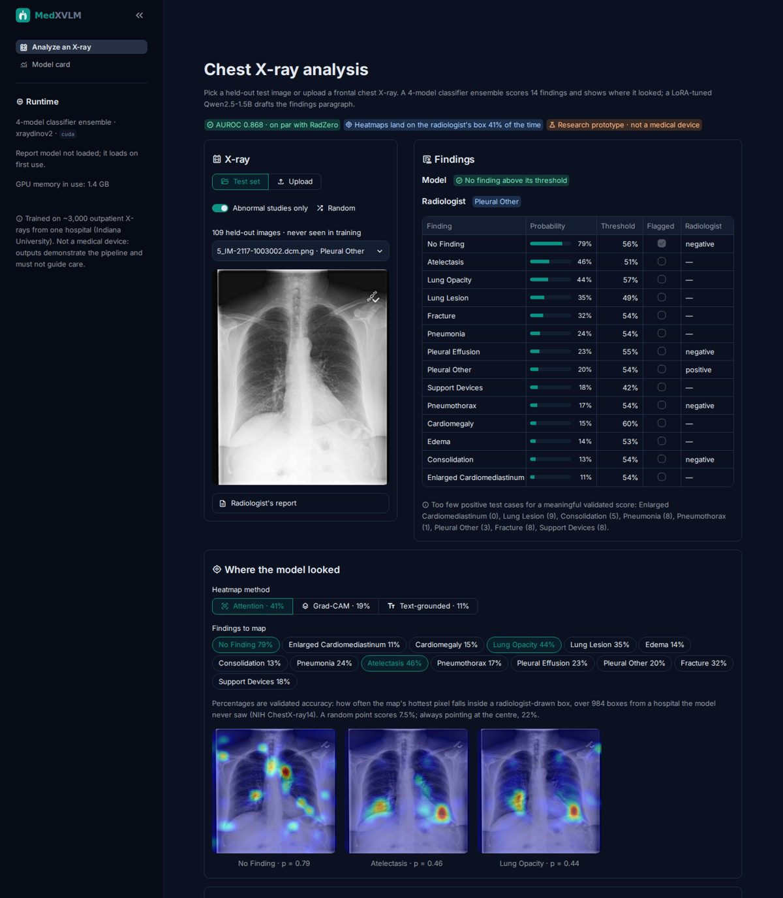
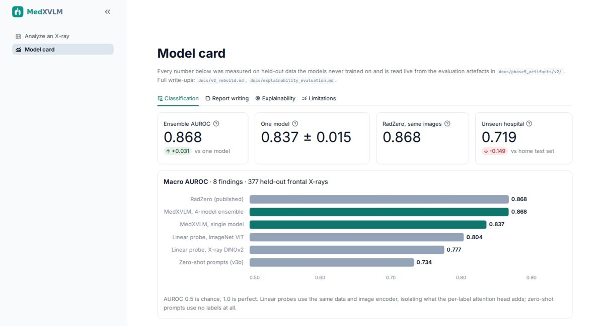

# MedXVLM

A multimodal vision-language system for chest X-ray understanding, built as
a B.Sc. AI & Data Science major project. MedXVLM aligns chest radiographs
and their free-text radiology reports into a shared embedding space, then
builds multi-label disease classification and automated report generation
on top of that shared representation, with explainability tooling
(Grad-CAM, attention maps, text-grounded heatmaps) throughout.

**Status: Phases 1–5 complete plus a post-Phase-5 rebuild (v2).** All
three stages are implemented, trained, and evaluated against two published
external models on identical held-out images. Current honest headline
numbers: image-only disease classification **0.837 ± 0.015 macro AUROC per
seed, 0.868 for the 4-seed ensemble** (RadZero on the same images: 0.868);
report generation clinical-efficacy F1 **0.176** with beam decoding (CheXOne:
0.149), device hallucination 3%; prompt-based zero-shot 0.734 (secondary). See
[Project status](#project-status), [docs/status_report.md](docs/status_report.md)
for every number's source, and [docs/v2_rebuild.md](docs/v2_rebuild.md) for
what changed and why.

## Target architecture

The system is built in three stages:

1. **Stage 1 — Contrastive alignment.** A BiomedCLIP-initialised ViT-B/16
   image encoder and PubMedBERT text encoder are aligned into a shared
   512-d embedding space using a combined global (image-report InfoNCE)
   and local (patch-word) contrastive loss.
2. **Stage 2 — Multi-label classification.** A 14-class CheXpert-style
   classifier head on top of the frozen/fine-tuned Stage 1 vision tower,
   using per-label attention pooling and gated fusion of text features.
3. **Stage 3 — Report generation.** Qwen2.5-1.5B-Instruct fine-tuned with
   LoRA, taking LLaVA-style projected visual tokens from the frozen Stage 1
   vision tower as a soft prompt to generate free-text findings.

**Explainability** (Grad-CAM, attention rollout, text-grounded heatmaps,
sentence attribution) is layered across all three stages rather than being
a separate stage.

## Dataset

[Indiana University Chest X-ray collection](https://www.kaggle.com/datasets/raddar/chest-xrays-indiana-university)
(Open-i), paired frontal/lateral chest radiographs with de-identified
narrative radiology reports. See [docs/project_proposal.md](docs/project_proposal.md)
for why this dataset was chosen over MIMIC-CXR / ChestX-ray14.

## Repository layout

```
medxvlm/
  configs/                   # training configs (align/classifier/baseline/report_gen .yaml)
  scripts/                   # standalone CLI entry points
  src/medxvlm/
    data/                    # datasets, manifests, transforms, rule-based labeler
    models/                  # encoders, heads, fusion modules, Stage 3 report generator
    engine/                  # training loop utilities (seeding, checkpointing, logging)
    explain/                 # grounding-heatmap snapshots
    eval/                    # classification + retrieval metrics
  docs/                      # literature review, proposal, environment notes, training results
  app/                       # Streamlit demo (app/app.py) over src/medxvlm/inference.py
  data/raw/                  # downloaded dataset (gitignored)
  data/processed/            # manifest.csv with real labels (gitignored)
  checkpoints/               # model weights (gitignored)
  runs/                      # TensorBoard + CSV logs, attention snapshots, generation samples (gitignored)
```

## Setup

Requires CUDA 12.8+ GPU wheels for `torch`/`torchvision` — see the header
comment in [requirements.txt](requirements.txt) for why (this project
targets an RTX 5080 / Blackwell / `sm_120`, which needs a recent wheel
index; older default PyPI builds will not see the GPU).

```bash
python -m venv .venv && source .venv/bin/activate   # or a conda env
pip install torch torchvision --index-url https://download.pytorch.org/whl/cu128
pip install -r requirements.txt
pip install -e .
```

Then validate the environment:

```bash
python scripts/verify_env.py
```

This prints Python/PyTorch/CUDA/GPU info and a pass/fail line per pinned
dependency, and exits non-zero if anything is missing or CUDA is
unavailable. See [docs/environment_check.md](docs/environment_check.md)
for a recorded run on the project's development machine.

## Dataset pipeline

Phase 1 left a toy dataloader (`src/medxvlm/data/toy_dataset.py`) that only
confirms the raw data is readable, with no cleaning, labelling, or
augmentation. The real pipeline, built in Phase 3:

```bash
python scripts/download_dataset.py     # pulls the dataset into data/raw/
python scripts/sanity_check_data.py    # smoke test: a few (image, report) pairs
python scripts/validate_labeler.py     # hand-written assertion suite for the rule-based labeler
python scripts/prepare_data.py         # builds data/processed/manifest.csv (real labels, uid-level split)
```

`prepare_data.py` runs `src/medxvlm/data/labeler.py` (a CheXpert-style
rule-based labeler: mention detection, bidirectional negation, pre/post
hedging, scope-breaking conjunctions, historical-qualifier demotion) once
per study, and writes one manifest with a `split` column from a uid-level
(not row-level) train/val/test split — a study's frontal and lateral
images share one report, so splitting by image row would leak report text
across splits. `src/medxvlm/data/dataset.py` then provides the real
`AlignmentDataset` / `ClassificationDataset` / `ReportGenDataset` classes
used by `scripts/train_*.py`.

## Training

Each stage has its own config-driven training script; batch size and
epoch count live in `configs/*.yaml`, not hardcoded in the scripts:

```bash
python scripts/train_baseline.py                                            # Phase 2's "before" case
python scripts/train_align.py --use-local-loss                              # Stage 1 (this is the ablation switch)
python scripts/train_classifier.py --stage1-checkpoint checkpoints/align/local_on/best.pt   # Stage 2
python scripts/train_report.py --stage1-checkpoint checkpoints/align/local_on/best.pt       # Stage 3
```

Only one GPU is available, so these run sequentially, never concurrently.
Each checkpoints best + last (by the relevant validation metric) under
`checkpoints/`, and logs per-epoch loss/metrics to both TensorBoard and a
plain CSV under `runs/` via `medxvlm.engine.loop_utils.EpochLogger`.

## Demo app

The Week-14 deliverable from the proposal, as a two-page Streamlit app with a light and a dark theme:

- **Analyze an X-ray** — pick a held-out test image (filter to abnormal studies, or hit *Random*) or upload a
  frontal X-ray → the 4-model ensemble's 14 finding probabilities with per-class thresholds and the radiologist's
  labels alongside → heatmaps in three methods (attention pooling, Grad-CAM, text-grounded), each labelled with its
  measured pointing-game accuracy on 984 radiologist boxes (41% / 19% / 11%; random point 7.5%) → a drafted findings
  report next to the radiologist's, with optional per-sentence attention maps.
- **Model card** — every headline number, read live from `docs/phase5_artifacts/v2/`, with comparison charts
  against RadZero, CheXOne and the baselines, plus the known limitations.





```bash
conda activate ml   # streamlit is not installed in the base env
PYTHONPATH=src streamlit run app/app.py
```

- **Trained weights are not in this repository** (`checkpoints/` is gitignored, ~12 GB). A fresh clone has the code and every
  reported number, but the app and eval scripts need the checkpoints: either retrain with the commands in *Training*
  (recipes in `configs/*_v2.yaml`, `align_v3b_findings.yaml`) or copy `checkpoints/` from the original machine.
- The classifier ensemble loads on start (~1.4 GB VRAM). The report writer loads on the first *Generate report*
  (~7 GB VRAM; *Options → Unload report model* frees it). Two report models: **v2** writes from the image (beam search
  by default) and **v2c** is told the classifier's flagged findings first (greedy by default; 0% invented devices; the
  app shows which findings it was given).
- Layout: `app/app.py` (entry point, navigation), `app/app_pages/{analyze,model_card}.py`, `app/common.py` (cached
  loaders), theme in `app/.streamlit/config.toml`. All inference logic is in `src/medxvlm/inference.py`
  (`MedXVLMPipeline`); the app is a thin view over it.
- Headless functional check (no browser needed; 7 user paths):
  `PYTHONPATH=src python scripts/sanity_check_app.py [--no-generator]`.

## Documentation

- [docs/literature_review.md](docs/literature_review.md) — the literature
  this project builds on, grouped by theme, and the gap it targets.
- [docs/project_proposal.md](docs/project_proposal.md) — problem
  statement, architecture, research questions, and project timeline.
- [docs/environment_check.md](docs/environment_check.md) — recorded
  `verify_env.py` output.
- [docs/code_review_notes.md](docs/code_review_notes.md) — Phase 2 model
  wiring review (what's stubbed, what the sanity checks do and don't cover).
- [docs/training_summary.md](docs/training_summary.md) — Phase 3 real
  training runs: what ran, final metrics, checkpoint paths, and anything
  cut short.
- [docs/ablation_study.md](docs/ablation_study.md) — local patch-word loss
  on vs. off, with the real comparison table.
- [docs/external_repro_feasibility.md](docs/external_repro_feasibility.md) /
  [docs/external_baseline_reproduction.md](docs/external_baseline_reproduction.md)
  — Phase 4: RadZero and CheXOne run here from their public weights; what was
  reproduced vs. only paper-reported.
- [docs/cross_dataset_evaluation.md](docs/cross_dataset_evaluation.md) —
  Phase 5: both external models on MedXVLM's held-out test split, with every
  comparison labelled apples-to-apples / not comparable. Found the Stage 2
  text-fusion leak and the Stage 3 collapse.
- [docs/v2_rebuild.md](docs/v2_rebuild.md) — the post-Phase-5 rebuild: labeler
  negation-scope fix, image-only Stage 2 on XrayDINOv2, Stage 3 retrain with
  abnormal oversampling; all current numbers and their caveats.
- [docs/explainability_evaluation.md](docs/explainability_evaluation.md) —
  heatmaps scored against 984 NIH radiologist boxes (attention pooling 41%
  pointing-game vs 7.5% random; Grad-CAM, rollout and text-grounded maps
  compared; RQ2/RQ4 answered) and sentence attribution for the report writer.
- [docs/status_report.md](docs/status_report.md) — sourced, section-by-section
  inventory of every checkpoint, log, metric and known issue in the repo.
- [docs/project_status_report.md](docs/project_status_report.md) — structured
  status report: what works, what is incomplete, architecture, next steps.
- [docs/project_summary_plain_language.pdf](docs/project_summary_plain_language.pdf)
  — the whole story for a non-expert reader (HTML source alongside).

## Project status

**Phases 1–5 complete; v2 rebuild complete (2026-09-19); overnight follow-ups, explainability evaluation and the v2c findings-conditioned Stage 3 complete (2026-09-21). Remaining: final report and presentation.**

- Phase 1 (skeleton, environment, literature review, proposal) and Phase 2
  (model wiring, `scripts/sanity_check_models.py`) — documented in
  [docs/environment_check.md](docs/environment_check.md) and
  [docs/code_review_notes.md](docs/code_review_notes.md).
- Phase 3 (real training of baseline, Stage 1 ×2, Stage 2 ×2, Stage 3) —
  [docs/training_summary.md](docs/training_summary.md). **Its Stage 2 headline
  (0.865) is superseded**: it was measured with the ground-truth report fused
  into the classifier; image-only the same checkpoint scores 0.51.
- Phase 4 (RadZero / CheXOne reproduced from public weights) and Phase 5
  (cross-dataset comparison on MedXVLM's own held-out split, flipped
  direction because their benchmarks need credentialed data).
- v2 rebuild: fixed a labeler negation bug (pneumothorax prevalence
  10% → 0.8%), retrained Stage 2 image-only on a CXR-pretrained encoder
  (**0.837 ± 0.015** per seed, **0.868 ensemble** vs RadZero 0.868, same
  images/labels), retrained Stage 3 (collapse fixed: 5 → 61 distinct outputs;
  CE F1 0.176 with beam decoding vs CheXOne 0.149; 3% hallucination).
- Overnight 2026-09-20 (`docs/v2_rebuild.md` §3.6): seed ensemble, decoding
  sweep, v2b ablation (30% oversampling collapses), zero-shot v3/v3b
  (finding-sentence training: 0.57 → 0.734).
- Stage 3 v2c, findings-conditioned generation (2026-09-21, `docs/v2_rebuild.md`
  §3.7): the classifier ensemble's flagged findings go into the prompt. Result:
  **0% device hallucination** (v2: 3%), CE F1 0.165 vs v2-beam 0.176 — a wash
  inside a ±0.10 noise band whose ceiling on the 70-image subsample is 0.234
  (a perfect verbaliser of the classifier). Stage 3 is now bounded by classifier
  recall on rare findings, not by the decoder. App default stays v2 + beam; v2c
  is selectable.
- Explainability evaluation 2026-09-21
  ([docs/explainability_evaluation.md](docs/explainability_evaluation.md)):
  the classifier's attention maps put their hottest pixel inside the
  radiologist's box on **41%** of 984 NIH boxes (random 7.5%, centre 21.5%);
  Grad-CAM 19%, class-agnostic rollout at chance; the local patch-word loss
  (RQ2) gives no measurable grounding at this scale; sentence attribution
  shows the report writer attends almost entirely to text, not the image.

Known open items: Stage 3 residual collapse (61% modal output with beam search) and its
near-zero visual attention; zero-shot head at 0.734 is data-scale-limited (13 points behind
RadZero); some test classes have single-digit positives after the label fix.
Full list: [docs/status_report.md](docs/status_report.md) §11; remaining work in
[docs/project_status_report.md](docs/project_status_report.md) §10.
